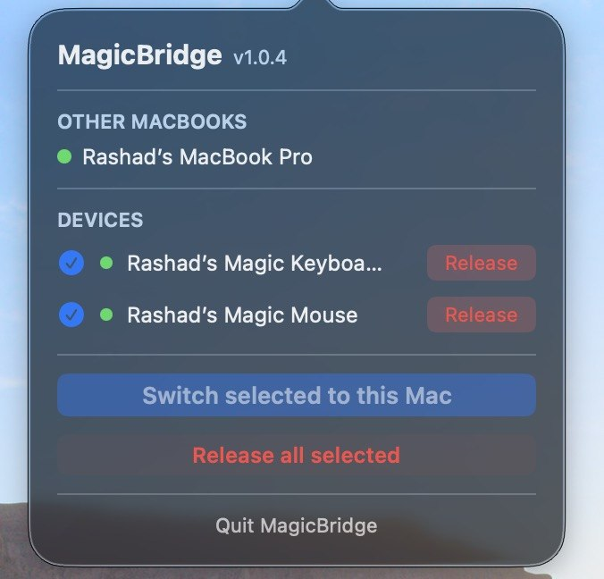

# MagicBridge

**One set of Magic devices. All of your Macs.**

MagicBridge is a free, open-source menu bar app that shares a Magic Keyboard, Magic Mouse, or Magic Trackpad between multiple Macs. Click once and the device jumps to the Mac you're sitting at. No re-pairing, no Bluetooth menus, no system dialogs.

  [](../../releases/latest)



## Why MagicBridge

Apple's Magic devices only pair with one Mac at a time. If you sit between a personal MacBook and a work MacBook, moving your keyboard means opening Bluetooth settings and re-pairing, every single time. MagicBridge turns that whole dance into a single click from your menu bar.

## Highlights

- **One-click handoff.** Click Connect and the device moves to this Mac. The other Mac is asked to let go first, automatically.
- **Truly silent switching.** No pairing prompts, no confirmation dialogs, no Bluetooth settings. It just switches.
- **Finds your Macs by itself.** Any Mac on your network running MagicBridge shows up automatically, and stays in sync through sleep, wake, and network changes.
- **Switch everything at once.** One action moves your whole desk: keyboard, mouse, and trackpad together.
- **Stays out of your way.** Lives in the menu bar with no dock icon, and can launch at login so your devices are always ready.
- **Remembers your setup.** Enable or disable devices individually; your choices survive restarts.
- **Free and open source.** MIT licensed, no accounts, no telemetry, nothing to pay for.

## Installation

### Homebrew

```bash
brew tap rashadansari/magicbridge https://github.com/RashadAnsari/MagicBridge
brew install --cask magicbridge
```

### Manual

1. Download `MagicBridge.zip` from the [latest release](../../releases/latest)
2. Unzip and drag `MagicBridge.app` into **Applications**, then launch it
3. Grant Bluetooth access when prompted
4. Repeat on every Mac you want to share devices with

The app is signed and notarized by Apple, so it opens without security warnings. On first launch you can enable **Launch at Login**.

## Usage

1. Click the menu bar icon to open the popover
2. **Other MacBooks** shows peers discovered on your network (green dot = reachable)
3. **Devices** lists all paired Magic devices
   - Click the circle to enable or disable a device
   - Click **Connect** to claim the device on this Mac
   - Click **Release** to let another Mac pick it up
4. **Switch selected to this MacBook** claims all enabled devices at once
5. **Release all selected** releases everything currently connected here

## How It Works

Each Mac running MagicBridge does a few things at once:

1. **Bluetooth monitoring.** Listens for IOBluetooth connect and disconnect events for instant UI updates, with a 60-second safety poll as backup.
2. **mDNS advertising.** Publishes a `_magicbridge._tcp` Bonjour record so other Macs can find it.
3. **Hello heartbeats.** Sends a `hello` to each known peer every 15 seconds (and immediately on wake); unresponsive peers are evicted within 45 seconds.
4. **Release protocol.** On Connect or Switch All, MagicBridge sends `release_devices` over TCP (port 57842) to every peer; the peer disconnects the devices and replies `devices_released` before the local Mac connects. If a peer doesn't answer in time, MagicBridge connects anyway and tells you.
5. **Silent pairing.** After a device is released, MagicBridge re-pairs it with an auto-confirming delegate, so no system dialog ever appears.
6. **Device persistence.** Enabled devices are stored in UserDefaults, so your list survives restarts even when devices are off or out of range.

## Requirements

- macOS 13.0 or later
- Two or more Bluetooth-enabled Macs on the same local network
- A Magic Trackpad, Magic Mouse, or Magic Keyboard

## Building from Source

Prerequisites: Xcode 15+ and [XcodeGen](https://github.com/yonaskolb/XcodeGen) (`brew install xcodegen`).

```bash
# Install dependencies (xcodegen)
make deps

# Build and install directly to /Applications (no code signing required)
make install

# Release build: signed, produces MagicBridge.app and MagicBridge.zip
make release
```

`make install` builds a debug binary, copies it to `/Applications/MagicBridge.app`, strips quarantine, and launches it. `make release` produces a signed `MagicBridge.app` and `MagicBridge.zip` in the project root (requires a Developer ID certificate; notarize the zip before distributing).

## License

[MIT](LICENSE) © Rashad Ansari
